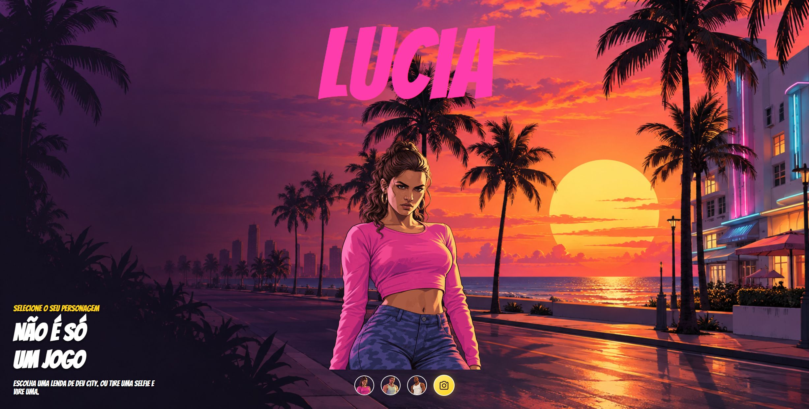

<div align="center">

# GTA · Seu personagem com IA

**Escolha uma lenda de Dev City. Ou transforme sua foto em uma.**

Projeto de portfólio de Gustavo Sales · HTML · CSS · JavaScript · Puter.js

[**Abrir demonstração →**](https://gustavosaless1.github.io/gta/) · [Conhecer o desenvolvedor](https://github.com/GustavoSaless1)

</div>

[](https://gustavosaless1.github.io/gta/)

## Sobre o projeto

Uma interface interativa inspirada no universo de GTA que combina seleção de personagens e geração de imagens com inteligência artificial. O visitante pode alternar entre Lucia, Jason e CJ ou enviar uma foto para criar seu próprio personagem ilustrado.

O projeto começou como exercício do evento DevClub e foi ampliado com integração ao Puter.js, validação de arquivos, mensagens de progresso e erro, retorno à imagem já gerada e ajustes de apresentação para diferentes tamanhos de tela. O desenvolvimento contou com apoio de IA.

## Experimente em poucos passos

1. **Abra a [demonstração online](https://gustavosaless1.github.io/gta/).** A seleção dos personagens está disponível sem login.
2. **Clique nos avatares** para trocar o personagem, o nome e a cor do destaque.
3. **Clique na câmera** para enviar uma foto e criar seu personagem. Essa etapa solicita acesso à conta Puter.
4. **Volte à sua miniatura** depois de selecionar outro personagem. Para substituir a criação, use **Gerar outra foto** e confirme.

> A geração de IA depende do serviço e dos créditos da conta Puter e pode ter custo. O resultado fica disponível enquanto a página está aberta; atualizar ou fechar a página remove a imagem da sessão.

## Funcionalidades

- Troca de personagens com atualização do nome, imagem e cor.
- Upload de fotos JPG, PNG e WebP de até 10 MB.
- Transformação de foto em personagem ilustrado por meio do Puter.js.
- Miniatura da criação para retornar ao resultado sem gerar novamente.
- Confirmação antes de escolher uma nova foto; a imagem anterior permanece disponível se a nova geração falhar.
- Mensagens de carregamento e erro e bloqueio do botão durante a geração.
- Layout com ajustes para telas menores, ícone de câmera em SVG e avisos acessíveis de status.

## Tecnologias e conceitos praticados

| Tecnologia | Aplicação no projeto |
| --- | --- |
| HTML5 | Estrutura da página, seleção de arquivos e controles de interação |
| CSS3 | Composição visual, Flexbox, Grid, tamanhos fluidos e media queries |
| JavaScript | Manipulação do DOM, eventos, funções e estado da imagem gerada |
| FileReader | Leitura da foto para envio ao serviço de IA |
| Promises e async/await | Espera pela leitura do arquivo e pela resposta da geração |
| try/catch/finally | Tratamento de falhas e liberação dos controles ao terminar |
| Puter.js | Autenticação e integração com geração de imagens |
| GitHub Pages | Publicação da demonstração |

## Executar localmente

O projeto não exige instalação de dependências nem uma etapa de compilação.

```bash
git clone https://github.com/GustavoSaless1/gta.git
cd gta
```

Abra a pasta no VS Code e use **Open with Live Server** no arquivo `index.html`. O endereço local costuma ser `http://localhost:5500/`.

**Importante:** abra pelo endereço do servidor. O login no Puter não funciona ao abrir o HTML diretamente pelo protocolo `file://`. A integração usa a conta Puter do visitante; nenhuma chave secreta precisa ser inserida no código.

## Estrutura

```text
gta/
├── index.html
├── README.md
├── docs/
│   └── preview.png
└── assets/
    ├── css/
    │   └── styles.css
    ├── js/
    │   └── scripts.js
    └── img/
```

## Autor e créditos

**Gustavo Sales** · [Perfil no GitHub](https://github.com/GustavoSaless1)

Projeto de estudo iniciado durante o evento DevClub. GTA e seus personagens pertencem aos respectivos titulares. Este projeto é uma demonstração educacional, sem vínculo oficial com a Rockstar Games.
